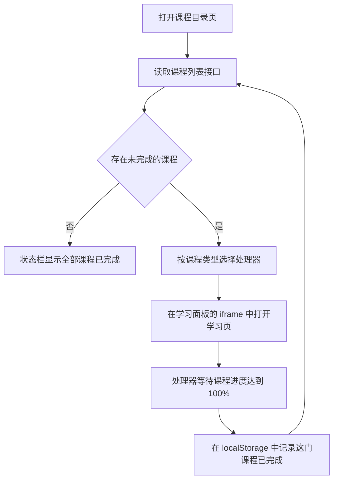

# enaeaHelperPlus

学习公社云平台(study.enaea.edu.cn)网课自动学习油猴脚本，支持视频课程与 VR 课程(icourse)。

> 仅供学习交流使用，下载后请于 24 小时内删除。

## 功能

- **在课程目录页内连续学习**：读取目录中的全部课程(不受表格分页限制)，在学习面板中按顺序打开未完成的课程，学完一门之后自动打开下一门，直到全部完成
- **视频课程**：静音、10 倍速播放，自动切换到未完成的章节，自动关闭学习中途弹出的暂停提示与答题对话框
- **VR 课程(icourse)**：学时由课程页自带的计时模块记录，脚本读取每次提交的结果，进度达到 100% 之后打开下一门。学习页中的全景场景来自第三方网站(酷雷曼、720云等)，可能自动播放背景音乐和解说，脚本一发现全景场景就将其移除，计时不受影响
- **必修课与选修课**：支持必修课目录页(`type=course`)与选修课目录页(`type=courseCategory4jwu`)
- **学习面板**：顶部状态栏显示当前课程、课程类型与进度
- **后台计时保活**：标签页在后台、窗口最小化或被其他窗口完全遮挡时，浏览器会把页面定时器限制到约每分钟执行一次，平台计时几乎停止。脚本在目录页持续输出一个 20 Hz、音量 0.001 的信号(低于人耳在该频率的听阈)，使页面不受这种限制

## 安装

1. 在浏览器中安装用户脚本管理扩展 [Tampermonkey](https://www.tampermonkey.net/)
2. 如果安装过原版 enaeaHelperPlus，先在 Tampermonkey 管理面板中删除原版脚本，避免两个脚本同时运行
3. 点击浏览器工具栏中的 Tampermonkey 图标，选择“添加新脚本”，清空编辑器中的模板，粘贴本仓库 [enaeaHelperPlus.js](enaeaHelperPlus.js) 的全部内容并保存

## 使用方法

1. 登录学习公社，进入班级，打开“课程学习”栏目(必修课目录页)或选修课目录页
2. 页面上出现学习面板之后，脚本自动开始学习。顶部红色状态栏显示当前课程与进度，下面一行显示后台计时保活的状态；如果提示“后台计时保活未开启”，点击这一行即可开启
3. 学习期间保持目录页打开，页面不需要停留在前台
4. 全部课程完成之后，状态栏显示“全部课程已完成”；如果存在脚本不支持的课程类型，状态栏会列出这些课程

中途刷新目录页之后脚本会重新开始，已经学完的课程不会重复学习。脚本因为平台停止计时等原因停止之后，状态栏保留停止原因，刷新目录页即可重新开始。

## 学时计算方式

课程页自带的计时模块每累计满 60 秒向服务器提交一次学时，课程进度等于已记录学时除以课程时长。

- **VR 课程**：学时按页面实际停留时间累计，所需时间等于课程时长
- **视频课程**：沿用 [sqhome-jin/enaeaHelperPlus](https://github.com/sqhome-jin/enaeaHelperPlus) 的播放方式(10 倍速播放，播放超过三分之一之后回到开头)，实测平台记录学时的速度约为真实时间的 3 到 4 倍

## 工作原理

脚本只在课程目录页运行。课程列表来自目录页使用的 `circleIndex.do` 课程列表接口，每门课程的学习页在学习面板的 iframe 中打开，学完之后移除 iframe，再打开下一门。



## 扩展课程类型

每种课程类型由一个处理器负责，把处理器加入脚本中的 `courseHandlers` 列表即可。处理器包含四个成员：

| 成员 | 说明 |
| --- | --- |
| `name` | 显示在状态栏上的类型名称 |
| `matches(course)` | 根据课程列表接口返回的 `studyCenterDTO` 判断这门课程是否由该处理器负责 |
| `lessonUrl(course, circleId)` | 课程学习页地址 |
| `study(lessonFrame, report)` | 学习页 iframe 创建之后立即调用，处理器自行等待需要的加载状态并完成学习。返回 Promise：学完之后 resolve，平台停止计时等无法继续的情况下 reject。调用 `report(message)` 更新状态栏 |

示例：

```js
function createExampleCourseHandler() {
    return {
        name: '示例',
        matches: (course) => course.coursecontentType === 'external_link' && course.courseExternalType === 'example',
        lessonUrl: (course, circleId) => '/viewerforexample.do?courseId=' + course.courseId + '&circleId=' + circleId,
        study: (lessonFrame, report) => new Promise((resolve, reject) => {
            // 在 lessonFrame 中完成学习，期间调用 report('进度 50%') 更新状态栏，学完之后调用 resolve()
        })
    };
}

let courseHandlers = [createVideoCourseHandler(), createICourseHandler(), createExampleCourseHandler()];
```

## 已知问题

- 课程列表中的进度只在重新打开课程目录页时同步，脚本在目录页内连续学习期间读到的列表进度不会变化。脚本把已确认学完的课程记录在浏览器 localStorage 中，避免重复打开
- 平台同一时间只为一门课程计时。学习期间在其他标签页或设备上打开课程，平台会弹出“系统检测到您正在同时观看多门课程”并停止计时，脚本随之停止

## 致谢

本项目在以下两个仓库的基础上继续开发，并保留了它们完整的提交历史：

- [xinyunaha/enaeaHelper](https://github.com/xinyunaha/enaeaHelper)：最初的学习公社网课助手脚本，提供视频加速播放、自动连播与自动跳转
- [sqhome-jin/enaeaHelperPlus](https://github.com/sqhome-jin/enaeaHelperPlus)：在 enaeaHelper 的基础上重构，加入课程目录页自动翻页与选修课支持

感谢两位作者以及参与贡献的各位开发者。

## 许可证

[MIT](LICENSE)
